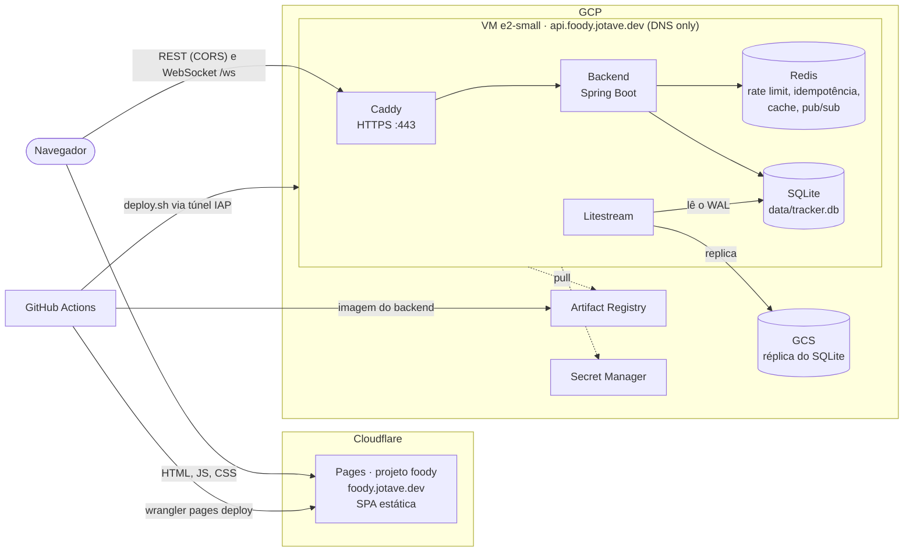

# Foody Delivery

[](https://github.com/JotaveX/foodyDelivery/actions/workflows/deploy.yml)

Mini rastreador de pedidos de delivery.

- `backend/` — Java 21, Spring Boot 3, Maven, SQLite
- `frontend/` — React, Vite, TypeScript
- `infra/` — deploy (docker compose, Caddy, Litestream, GitHub Actions)

## Arquitetura de produção



- **Frontend** no Cloudflare Pages (upload direto pelo GitHub Actions, sem integração Git). Em
  produção a SPA chama `https://api.foody.jotave.dev` e `wss://api.foody.jotave.dev/ws`
  (`VITE_API_URL` e `VITE_WS_URL`, definidas no build). Em dev, o proxy do Vite continua servindo
  `/api` e `/ws`.
- **API** numa VM do GCP com docker compose: Caddy (TLS automático) → backend, com Redis e o
  Litestream replicando o SQLite para o GCS. O registro DNS da API fica **sem proxy** da
  Cloudflare, para o Caddy emitir o próprio certificado e o rate limit ver o IP real do cliente.
- **CORS**: o backend aceita só `https://foody.jotave.dev` em produção (`CORS_ALLOWED_ORIGINS`;
  em dev, `http://localhost:5173`), a mesma lista usada no `Origin` do WebSocket.
- **Deploy**: todo push na `main` roda os testes e depois publica backend e frontend
  (`.github/workflows/deploy.yml`). PRs ganham um preview do front no Pages, com a URL comentada
  no PR. Passo a passo da infraestrutura em [`infra/SETUP.md`](infra/SETUP.md).

## Rodando localmente

```bash
docker compose up -d                     # Redis e Mailpit
cd backend && ./mvnw spring-boot:run     # API
cd frontend && npm install && npm run dev
```

## Idempotência e rate limit

Ambos guardam estado no Redis, então valem para todas as instâncias da API.

### `Idempotency-Key` no `POST /orders`

Header opcional com um UUID. O front gera um ao abrir o formulário de novo pedido e o reutiliza em
toda retentativa do envio.

| Situação | Resposta |
|---|---|
| Primeira vez com a chave | Cria o pedido e guarda status, `Location` e corpo por 24h (`app.idempotency.ttl`) |
| Mesma chave e mesmo corpo, já concluída | Devolve a resposta salva, com `Idempotent-Replayed: true` |
| Mesma chave, corpo diferente | `422` |
| Mesma chave, primeira requisição ainda rodando | `409` (tente de novo em instantes) |
| Requisição falhou (exceção ou 5xx) | A chave é liberada, e a retentativa roda de novo |

A chave no Redis é `idem:{userId}:{key}`, então cada usuário tem as suas. O comportamento vem da
anotação `@Idempotent` (`IdempotencyAspect`) e serve para qualquer endpoint autenticado que
retorne `ResponseEntity`.

### Rate limit (Bucket4j + Redis)

| Escopo | Rota | Limite padrão |
|---|---|---|
| IP | `POST /auth/login` | 5/min |
| IP | `POST /auth/register` | 3/min |
| IP | `POST /auth/forgot-password` | 3/min (já configurado para quando a rota existir) |
| Usuário | toda requisição autenticada | 100/min |

Os limites ficam em `app.rate-limit` no `application.yml` (`RATE_LIMIT_ENABLED=false` desliga
todos). As respostas trazem `X-RateLimit-Remaining`. Quem passa do limite recebe `429` em
ProblemDetail com `Retry-After` (segundos). Se o Redis cair, o rate limit deixa as requisições
passarem em vez de derrubar a API.

**IP real e proxy confiável.** O `X-Forwarded-For` é só um header: qualquer cliente pode inventar
um. Por isso a API só o lê quando a conexão TCP vem de um proxy listado em
`RATE_LIMIT_TRUSTED_PROXIES` (IPs ou CIDRs, separados por vírgula; vazio por padrão, e aí o header
é ignorado). Em produção, aponte essa variável para o endereço do Caddy na rede do Docker (ex.: a
sub-rede do compose; o `docker-compose.prod.yml` fixa o Caddy em `172.30.0.10`). Sem `trusted_proxies` próprio, o Caddy substitui o
`X-Forwarded-For` que vem da internet pelo IP real do cliente. A API percorre o header da direita
para a esquerda, pulando os proxies confiáveis, e o primeiro endereço não confiável é o do cliente.
Nunca inclua uma faixa que clientes da internet alcancem diretamente.

## Atualizações em tempo real (WebSocket + STOMP)

O front se conecta em `/ws` (STOMP sobre WebSocket puro) e assina `/topic/orders` (lista) e
`/topic/orders/{id}` (detalhe). Cada mensagem é o pedido completo, no mesmo formato do
`GET /orders/{id}`.

- **Autenticação:** o JWT vai no header `Authorization: Bearer …` do frame `CONNECT`, nunca na
  URL (que acabaria em logs de proxy). O `StompAuthInterceptor` aplica a mesma validação do
  filtro HTTP, incluindo o `token_version`; sem token válido o `CONNECT` é recusado. Clientes só
  podem fazer `SUBSCRIBE` em `/topic/**`; `SEND` é recusado.
- **Fan-out pelo Redis:** depois do commit (`@TransactionalEventListener(AFTER_COMMIT)`), o pedido
  é publicado no canal Redis `order-events`. Toda instância assina esse canal e repassa a
  mensagem para os seus clientes pelo broker local. Assim, com várias instâncias, o cliente recebe
  a mudança mesmo conectado em outra instância que não a que a processou.
- **Origens:** as mesmas do CORS, `CORS_ALLOWED_ORIGINS` (origens exatas separadas por vírgula; em
  dev, `http://localhost:5173`).

## Cache de pedidos (Spring Cache + Redis)

O `GET /orders/{id}` é cacheado no Redis. Para ser honesto: **não havia gargalo medido**. Uma leitura
por id no SQLite é rápida, e o cache está aqui para demonstrar a estratégia de invalidação, não
por necessidade de desempenho.

- **O que é cacheado:** o DTO `OrderDetail` em JSON (serializer tipado, sem informação de tipo
  polimórfica no payload), nunca a entidade JPA. A chave é `cache:order-details:{id}` e o TTL é de
  10 minutos.
- **Invalidação orientada a eventos:** quem remove a entrada é o `OrderCacheEvictor`, que escuta o
  `OrderChangedEvent` com `@TransactionalEventListener(AFTER_COMMIT)`. A remoção não fica no
  método que altera o pedido: se ficasse, uma leitura concorrente poderia recolocar no cache um
  estado que ainda não foi commitado, ou que nunca será, caso a transação falhe depois.
- **Listagem fora do cache:** cada combinação de página, tamanho e filtro de status seria uma
  entrada, e qualquer mudança de pedido teria de invalidar todas. O custo seria alto e o ganho
  pequeno, para uma consulta indexada que já é barata.
- **Redis fora do ar:** um `CacheErrorHandler` registra o erro em log e trata como cache miss, e a
  leitura segue para o banco. Os timeouts do Redis são de 1s (`spring.data.redis.timeout`), para
  que um Redis travado não segure a requisição. Uma entrada que não desserializa (por exemplo, após
  mudar o formato do DTO) cai no mesmo caminho.
- **Limite conhecido:** uma leitura que começou antes de um commit pode gravar no cache o estado
  anterior logo depois da remoção (corrida clássica do cache-aside). O TTL limita essa janela a
  10 minutos. O tempo real (WebSocket) não depende do cache, porque publica o snapshot do próprio
  evento.
