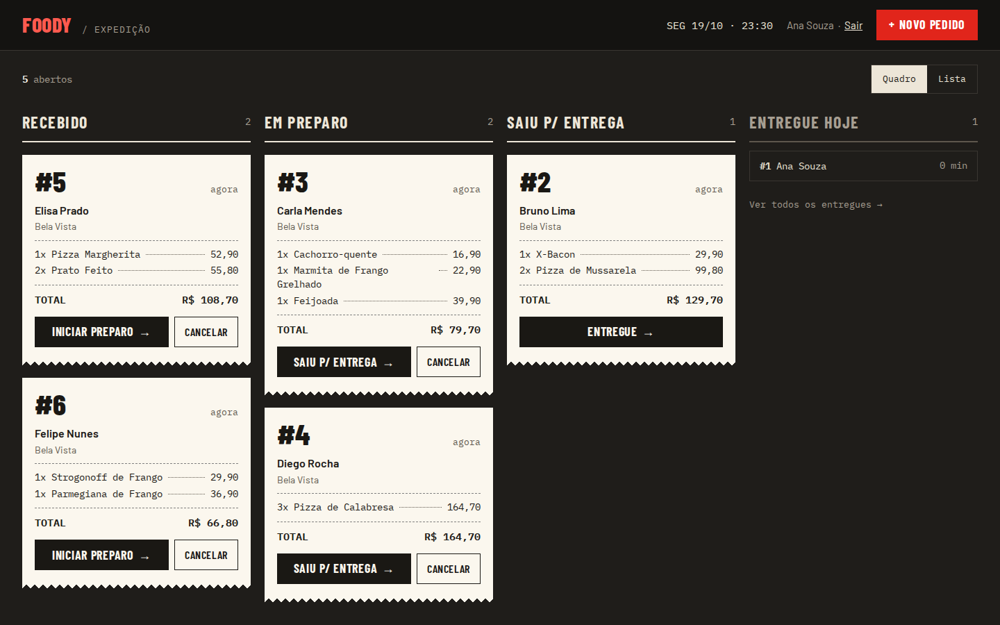
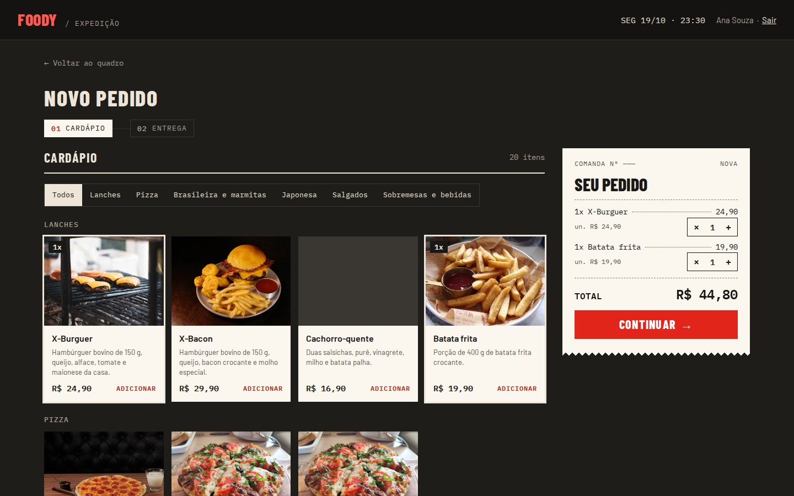
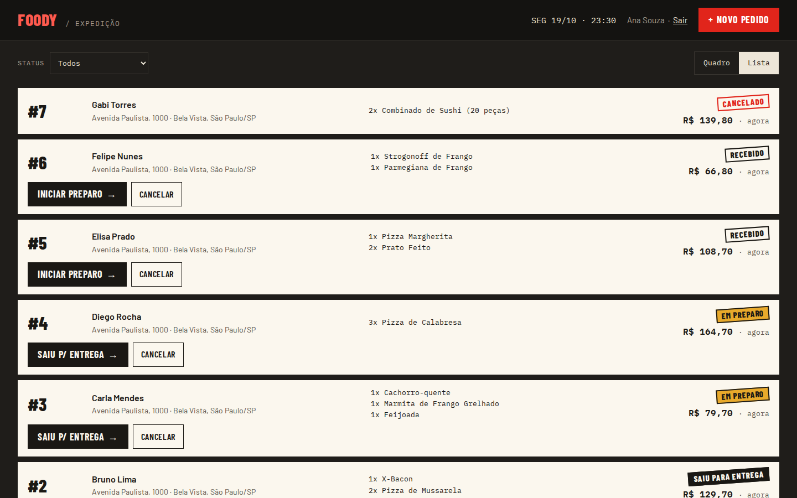
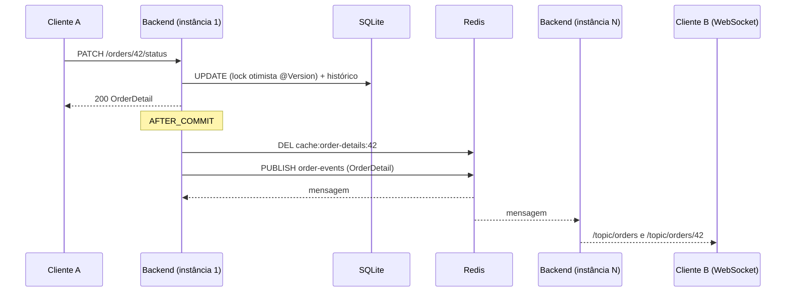
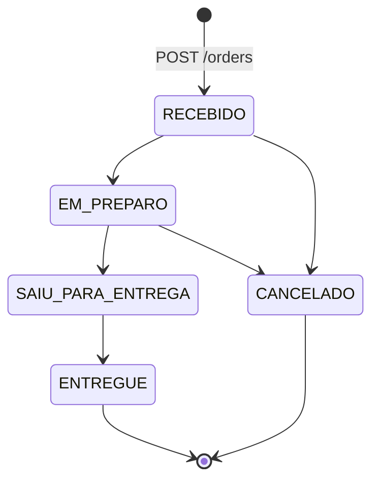
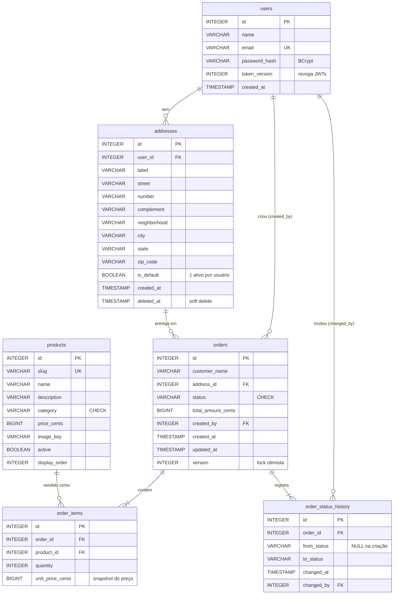

# Foody Delivery — mini rastreador de pedidos

[](https://github.com/JotaveX/foody-delivery/actions/workflows/ci.yml)
[](https://github.com/JotaveX/foody-delivery/actions/workflows/deploy.yml)

Rastreador de pedidos de delivery: cadastro e login, criação de pedidos a partir de um cardápio,
quadro de cozinha com os pedidos por status e atualização em tempo real entre navegadores.

- **Produção:** <https://foody.jotave.dev>
- **Swagger (produção):** <https://api.foody.jotave.dev/swagger-ui.html>

| Parte | Stack |
|---|---|
| `backend/` | Java 21, Spring Boot 3.5, Maven, SQLite (WAL) + Flyway, Redis, STOMP sobre WebSocket |
| `frontend/` | React 19, Vite, TypeScript, TanStack Query, React Hook Form + Zod |
| `e2e/` | Playwright (Chromium) contra a stack de dev |
| CI/CD | GitHub Actions: testes em todo PR e push; deploy a cada push na `main` |

Todo erro da API sai como [RFC 9457](https://www.rfc-editor.org/rfc/rfc9457) (`ProblemDetail`) com
mensagem em português e, nos erros de validação, um mapa `errors` por campo.

## Sumário

- [Demonstração](#demonstração)
- [Pré-requisitos](#pré-requisitos)
- [Instalação](#instalação)
- [Uso](#uso)
- [Testes e hooks do Git](#testes-e-hooks-do-git)
- [Arquitetura](#arquitetura)
- [Modelo de dados](#modelo-de-dados)
- [Endpoints](#endpoints)

## Demonstração

Em produção: <https://foody.jotave.dev>.

**Quadro da cozinha**: pedidos por status, avançados com um clique e sincronizados entre navegadores.



**Novo pedido**: cardápio por categoria e comanda com o total; a entrega é o segundo passo.



<details>
<summary>Visão em lista, com filtro por status</summary>



</details>

## Pré-requisitos

O projeto sobe **sem nenhuma credencial real**: toda dependência externa tem um substituto local
(Redis em container, e-mail no [Mailpit](https://mailpit.axllent.org/), imagens do catálogo lidas
de um bucket público).

- **Só com Docker:** Docker com o Compose v2.
- **Desenvolvimento com hot reload:** Java 21, Node 24 (LTS) e Docker (para Redis e Mailpit).

## Instalação

### Com Docker (um comando)

```bash
docker compose up --build
```

| O quê | Onde |
|---|---|
| Aplicação | <http://localhost:5173> |
| Swagger | <http://localhost:8080/swagger-ui.html> |
| Mailpit (e-mails de redefinição de senha) | <http://localhost:8025> |

O compose sobe Redis, Mailpit, o backend (perfil `dev`, com segredos de desenvolvimento) e o
frontend já compilado atrás de um nginx, que faz o papel do proxy do Vite (`/api` e `/ws` vão para
o backend). O SQLite fica no volume `backend-data`; `docker compose down -v` apaga os dados. As
portas mudam com `FRONTEND_PORT` e `BACKEND_PORT`.

### Sem Docker para a aplicação

Para desenvolver com hot reload. Redis e Mailpit continuam no compose (ou rode os seus em `localhost:6379` e `localhost:1025`):

```bash
docker compose up -d redis mailpit

cd backend && ./mvnw spring-boot:run          # API em http://localhost:8080
cd frontend && npm install && npm run dev     # SPA em http://localhost:5173
```

O Vite encaminha `/api` e `/ws` para `http://localhost:8080` (`BACKEND_URL` muda o destino). O
banco fica em `backend/data/tracker.db` (`SQLITE_PATH` muda o caminho) e o Flyway cria o schema
e o cardápio na primeira subida.

<details>
<summary>Variáveis de ambiente do backend</summary>

| Variável | Padrão em dev | Uso |
|---|---|---|
| `SQLITE_PATH` | `./data/tracker.db` | Arquivo do SQLite |
| `REDIS_HOST` / `REDIS_PORT` / `REDIS_PASSWORD` | `localhost` / `6379` / vazio | Redis |
| `JWT_SECRET` | segredo fixo só de dev | Obrigatório em `prod` (≥ 32 bytes) |
| `JWT_EXPIRATION` | `PT2H` | Validade do JWT (access token) |
| `REFRESH_TOKEN_TTL` | `P7D` | Validade do refresh token; cada renovação emite um novo com o prazo cheio |
| `MAIL_PROVIDER` | `smtp` (Mailpit) | `resend` em produção, com `RESEND_API_KEY` e `MAIL_FROM` |
| `SMTP_HOST` / `SMTP_PORT` | `localhost` / `1025` | SMTP quando `MAIL_PROVIDER=smtp` |
| `PASSWORD_RESET_URL` | `http://localhost:5173/reset-password` | Página do link enviado por e-mail |
| `CORS_ALLOWED_ORIGINS` | `http://localhost:5173` | Origens exatas aceitas no CORS e no `/ws` |
| `CORS_ALLOWED_ORIGIN_PATTERNS` | vazio | Padrões, como `https://*.foody.pages.dev` |
| `RATE_LIMIT_ENABLED` | `true` | `false` desliga o rate limit (a suíte E2E exige) |
| `RATE_LIMIT_TRUSTED_PROXIES` | vazio | IPs/CIDRs cujo `X-Forwarded-For` é confiável |
| `CATALOG_IMAGE_BASE_URL` | bucket público do GCS | Prefixo das URLs das imagens |

</details>

## Uso

Pela interface: crie uma conta em `/register` e faça o primeiro pedido; o endereço é cadastrado
junto com ele e vira o padrão. Abra o quadro em dois navegadores para ver o status mudar em tempo
real.

Pela API (com o compose de pé, em `http://localhost:8080`):

```bash
API=http://localhost:8080

curl -X POST $API/auth/register -H 'Content-Type: application/json' \
  -d '{"name":"Maria","email":"maria@exemplo.com","password":"senha-segura-123"}'

TOKEN=$(curl -s -X POST $API/auth/login -H 'Content-Type: application/json' \
  -d '{"email":"maria@exemplo.com","password":"senha-segura-123"}' | jq -r .token)

# Cardápio (o id 1 é o X-Burguer)
curl "$API/products?category=LANCHES" -H "Authorization: Bearer $TOKEN"

# Pedido com o primeiro endereço; a Idempotency-Key evita duplicar em retentativas
curl -X POST $API/orders -H "Authorization: Bearer $TOKEN" -H 'Content-Type: application/json' \
  -H 'Idempotency-Key: 3f6c1a2e-8d4b-4c1e-9a7f-2b5d6e8f0a13' \
  -d '{"customerName":"Maria","items":[{"productId":1,"quantity":2}],
       "newAddress":{"label":"Casa","street":"Avenida Paulista","number":"1000",
                     "neighborhood":"Bela Vista","city":"São Paulo","state":"SP","zipCode":"01310-100"}}'

# Avança o status (transição inválida responde 409)
curl -X PATCH $API/orders/1/status -H "Authorization: Bearer $TOKEN" \
  -H 'Content-Type: application/json' -d '{"status":"EM_PREPARO"}'
```

A lista completa de rotas está em [Endpoints](#endpoints) e no Swagger (`/swagger-ui.html`).

## Testes e hooks do Git

| Suíte | Comando | O que cobre |
|---|---|---|
| Backend, unitários | `cd backend && ./mvnw test` | `*Test` no Surefire: máquina de estados, dinheiro em centavos, JWT, resolução de IP, e-mail, handler de erros |
| Backend, integração | `cd backend && ./mvnw verify` | Unitários + `*IT` no Failsafe + `spotless:check`. Sobe o contexto Spring com Redis real via **Testcontainers** (requer Docker) e SQLite em diretório temporário |
| Frontend | `cd frontend && npm run test:ci` (`npm test` em watch) | Vitest + Testing Library + MSW: páginas, rotas protegidas, cache de pedidos e atualizações por WebSocket |
| Frontend, lint e build | `npm run lint && npm run build` | oxlint e type-check do TypeScript |
| E2E | `cd e2e && npm test` | Playwright no Chromium contra a stack de dev rodando |

Um teste específico: `./mvnw -Dtest=OrderStatusTest test` ou `./mvnw -Dit.test=OrderIT verify`.

**E2E.** A suíte cadastra e faz login muitas vezes do mesmo IP, então o backend precisa subir sem
rate limit (um `globalSetup` confere e para com uma mensagem clara se ele estiver ligado):

```bash
docker compose up -d redis mailpit
cd backend && RATE_LIMIT_ENABLED=false ./mvnw spring-boot:run
cd frontend && npm run dev
cd e2e && npm install && npx playwright install chromium && npm test   # relatório: npm run report
```

Cenários: cadastro → primeiro pedido com endereço novo → quadro; status em tempo real entre dois
navegadores, sem recarregar; redefinição de senha com o link lido na API do Mailpit; endereço novo
marcado como padrão. O ViaCEP é simulado no navegador, então a suíte não depende da internet.

### Hooks do Git

`npm install` na raiz instala os hooks ([husky](https://typicode.github.io/husky/)). O
`package.json` da raiz só tem esse tooling. Cada hook pula a parte do monorepo que não foi tocada.

| Hook | O que executa |
|---|---|
| `commit-msg` | `commitlint` com `@commitlint/config-conventional` (Conventional Commits) |
| `pre-commit` | `lint-staged`: `oxlint --fix` e `prettier --write` nos arquivos staged de `frontend/`. Com arquivos de `backend/` staged: `./mvnw spotless:check test` (só unitários). Com arquivos de `frontend/` staged: `vitest run` |
| `pre-push` | Olha os arquivos dos commits sendo enviados. Backend: `./mvnw verify` (unitários, integração e formatação). Frontend: `npm run lint && npm run test:ci && npm run build`. Branch nova sem base conhecida: roda tudo |

Os hooks são conveniência (`--no-verify` os pula). O guardrail definitivo é o CI
(`.github/workflows/ci.yml`): formatação, `mvn verify`, lint, testes e build do front e a suíte E2E
em todo PR, e de novo antes de cada deploy. Se o `spotless:check` falhar, rode
`./mvnw spotless:apply` em `backend/`.

## Arquitetura

### Componentes em produção


- **Frontend** no Cloudflare Pages, publicado pelo GitHub Actions. Em produção a SPA chama
  `https://api.foody.jotave.dev` e `wss://api.foody.jotave.dev/ws` (`VITE_API_URL`/`VITE_WS_URL`,
  definidas no build); em dev, `/api` e `/ws` na mesma origem, pelo proxy do Vite (ou do nginx, no
  compose). PRs ganham um preview do front no Pages, com a URL comentada no PR.
- **API** numa VM e2-micro (1 GB de RAM) com docker compose: Caddy (TLS automático) → backend,
  Redis e Litestream. O DNS da API fica sem o proxy da Cloudflare, para o Caddy emitir o próprio
  certificado e o rate limit ver o IP real do cliente. A JVM roda com heap fixo de 350 MB, serial
  GC e só o C1, para caber na máquina.
- **Litestream** replica o WAL do SQLite para um bucket privado do GCS a cada poucos segundos. Na
  subida, um container `litestream restore` recupera o banco se o disco da VM for perdido.
- **Imagens do catálogo** num bucket público do GCS, que o navegador lê direto, sem passar pela
  VM. A VM só tem permissão de escrita no bucket do Litestream.
- **Segredos** (`JWT_SECRET`, `RESEND_API_KEY`) ficam no Secret Manager; o deploy usa Workload
  Identity Federation, sem chave de service account. Os arquivos de infraestrutura (compose de
  produção, Caddyfile, Litestream, script de deploy) ficam só na VM e não estão neste repositório.

### Backend por feature

Pacotes por feature, não por camada: `auth`, `user`, `address`, `order`, `catalog`, `idempotency`,
`ratelimit`, `realtime`, `mail`, `cache`, `observability`, `common`. Controllers só recebem e
devolvem DTOs (records); entidades JPA nunca saem do serviço.

Fluxo de uma mudança de status:



### Máquina de estados do pedido



As regras ficam em `OrderStatus.canTransitionTo`. O status só muda por `Order.changeStatus`, que
recusa transições inválidas com **409** (o corpo traz `currentStatus` e `requestedStatus`) e grava
uma linha em `order_status_history` com quem mudou e quando. A criação registra `null → RECEBIDO`.
Depois de entregue, o pedido não pode mais ser cancelado. O front espelha a tabela só para decidir
quais botões mostrar; a fonte da verdade é o backend.

## Modelo de dados

Schema versionado pelo Flyway (`backend/src/main/resources/db/migration`); o Hibernate só valida
(`ddl-auto=validate`).



- **Não existe tabela de tokens de redefinição de senha.** O token (256 bits aleatórios) só viaja
  no e-mail; o Redis guarda o SHA-256 dele em `pwreset:{hash}` → `userId:tokenVersion`, com TTL de
  30 minutos, consumido com `GETDEL` (uso único). Um dump do Redis não contém links utilizáveis, e
  a troca de senha incrementa `token_version`, o que invalida os outros links pendentes e todos os
  JWTs emitidos antes.
- **Dinheiro em centavos (`BIGINT`).** O SQLite não tem decimal exato (`DECIMAL` vira `REAL`). Na
  API e no domínio é `BigDecimal` com 2 casas; o `MoneyCentsConverter` recusa frações de centavo.
- **`products` é dado de referência** semeado por migration (20 produtos, igual em todos os
  ambientes); não há rota de escrita. Mudar o cardápio é uma nova migration.
- **Sem `ON DELETE CASCADE`:** nada é apagado fisicamente, e `orders.address_id` aponta para a
  versão exata do endereço usada na entrega.
- Índices: `ux_addresses_default` (único parcial: um só endereço padrão ativo por usuário),
  `status` e `created_at` de `orders` para a listagem, e as FKs.

## Endpoints

Base: `http://localhost:8080` em dev, `https://api.foody.jotave.dev` em produção. Tudo exige
`Authorization: Bearer <jwt>`, exceto as rotas marcadas como públicas. A documentação interativa
está no Swagger (`/swagger-ui.html`, spec em `/v3/api-docs`).

| Método | Rota | Descrição | Respostas notáveis |
|---|---|---|---|
| `POST` | `/auth/register` | Cadastro (nome, e-mail, senha). **Pública** | 201, 400, 409 e-mail já cadastrado |
| `POST` | `/auth/login` | Troca e-mail e senha por um JWT e põe o refresh token no cookie `foody_refresh`. **Pública** | 200 `{ token, expiresIn, refreshExpiresIn, user }` + `Set-Cookie`, 401 genérico |
| `POST` | `/auth/refresh` | Troca o cookie `foody_refresh` por um JWT novo e o próximo refresh token (uso único). **Pública** | 200 como o login, 401 sessão expirada (e apaga o cookie) |
| `POST` | `/auth/logout` | Revoga o refresh token e apaga o cookie. **Pública** | Sempre 204 |
| `GET` | `/auth/me` | Usuário atual com o endereço padrão | 200 |
| `POST` | `/auth/forgot-password` | Envia o link de redefinição por e-mail. **Pública** | Sempre 204 |
| `POST` | `/auth/reset-password` | Nova senha com o token do e-mail. **Pública** | 204, 400 token inválido/expirado |
| `GET` | `/products?category=` | Cardápio ativo, na ordem do menu | 200, `Cache-Control: public, max-age=300` |
| `POST` | `/orders` | Cria pedido: `customerName`, `items: [{ productId, quantity }]` e `addressId` **ou** `newAddress` (+ `saveAsDefault`). Header opcional `Idempotency-Key` | 201 + `Location`, 400, 409, 422 produto ou endereço inválido |
| `GET` | `/orders?status=&page=&size=` | Lista paginada, mais novos primeiro (`size` de 1 a 100) | 200 `{ content, page, size, totalElements, totalPages }` |
| `GET` | `/orders/{id}` | Pedido com itens, total e endereço de entrega | 200, 404 |
| `PATCH` | `/orders/{id}/status` | `{ "status": "EM_PREPARO" }` | 200, 409 transição inválida ou conflito |
| `GET` | `/orders/{id}/history` | Histórico de status, mais antigo primeiro | 200, 404 |
| `GET` | `/addresses` | Endereços ativos do usuário, padrão primeiro | 200 |
| `GET` | `/addresses/{id}` | Um endereço ativo do usuário | 200, 404 |
| `POST` | `/addresses` | `{ address, makeDefault }` | 201 |
| `PUT` | `/addresses/{id}` | Edita: cria uma nova versão (novo id) | 200, 404 |
| `PATCH` | `/addresses/{id}/default` | Torna o endereço padrão | 200, 404 |
| `DELETE` | `/addresses/{id}` | Soft delete | 204, 404, 409 padrão ou último endereço |
| `GET` | `/actuator/health/liveness` · `/readiness` | Probes (readiness inclui o Redis). **Públicas** | 200, 503 |
| `WS` | `/ws` | STOMP; JWT no frame `CONNECT`. Tópicos `/topic/orders` e `/topic/orders/{id}` (o `OrderDetail` completo) | `ERROR` sem token válido |

Toda resposta autenticada traz `X-RateLimit-Remaining`; acima do limite, **429** com `Retry-After`.
Toda resposta traz `X-Correlation-Id` (aceito do cliente ou gerado), que também vai nos logs e no
corpo dos erros 500.
