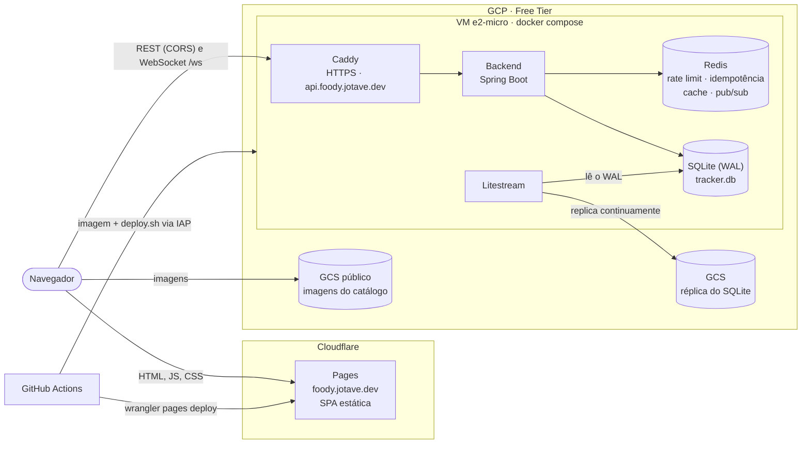
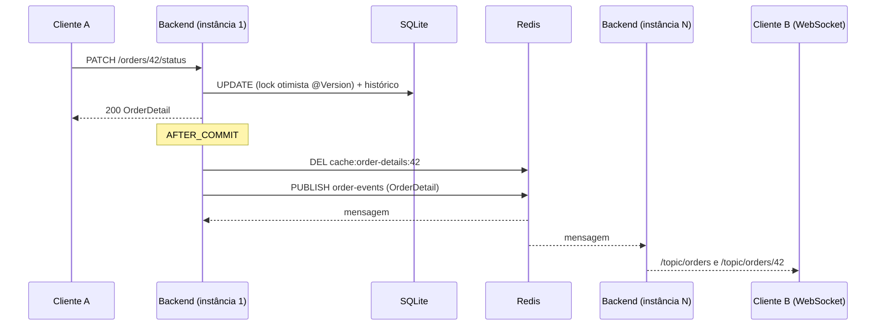
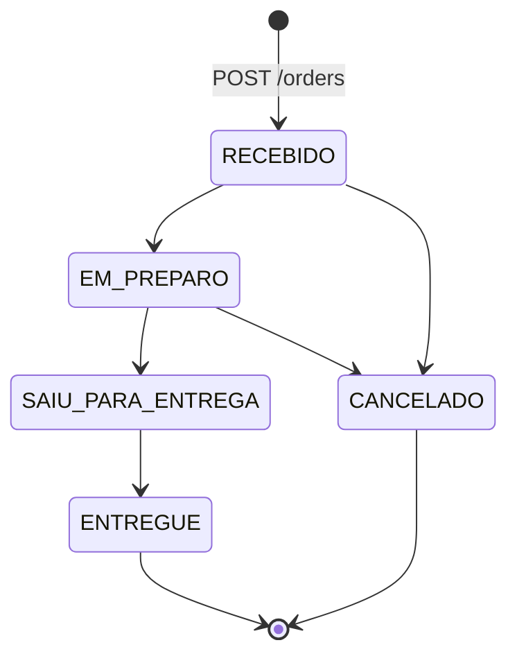
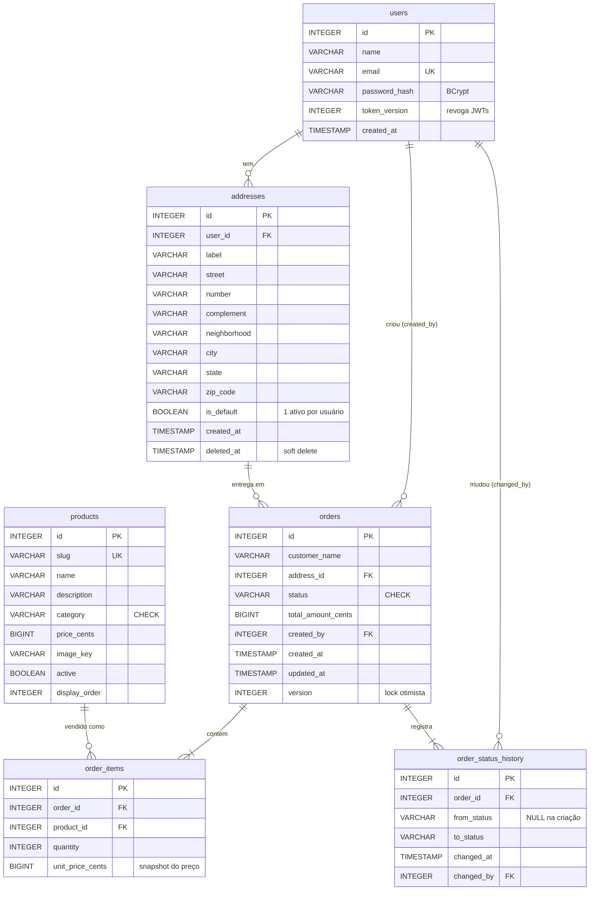

# Foody Delivery — mini rastreador de pedidos

[](https://github.com/JotaveX/foody-delivery/actions/workflows/deploy.yml)

Rastreador de pedidos de delivery: cadastro e login, criação de pedidos a partir de um cardápio,
quadro de cozinha com os pedidos por status e atualização em tempo real entre navegadores.

- **Produção:** <https://foody.jotave.dev>
- **Swagger (produção):** <https://api.foody.jotave.dev/swagger-ui.html>

| Parte | Stack |
|---|---|
| `backend/` | Java 21, Spring Boot 3.5, Maven, SQLite (WAL) + Flyway, Redis, STOMP sobre WebSocket |
| `frontend/` | React 19, Vite, TypeScript, TanStack Query, React Hook Form + Zod |
| `e2e/` | Playwright (Chromium) contra a stack de dev |
| CI/CD | GitHub Actions: testes em todo PR e push; deploy a cada push na `main` |

Todo erro da API sai como [RFC 9457](https://www.rfc-editor.org/rfc/rfc9457) (`ProblemDetail`) com
mensagem em português e, nos erros de validação, um mapa `errors` por campo.

## Sumário

- [Como rodar](#como-rodar)
- [Testes e hooks do Git](#testes-e-hooks-do-git)
- [Arquitetura](#arquitetura)
- [Modelo de dados](#modelo-de-dados)
- [Endpoints](#endpoints)
- [Decisões e trade-offs](#decisões-e-trade-offs)
- [O que eu faria com mais tempo](#o-que-eu-faria-com-mais-tempo)

## Como rodar

O projeto sobe **sem nenhuma credencial real**: toda dependência externa tem um substituto local
(Redis em container, e-mail no [Mailpit](https://mailpit.axllent.org/), imagens do catálogo lidas
de um bucket público).

### Com Docker (um comando)

Requer Docker com o Compose v2.

```bash
docker compose up --build
```

| O quê | Onde |
|---|---|
| Aplicação | <http://localhost:5173> |
| Swagger | <http://localhost:8080/swagger-ui.html> |
| Mailpit (e-mails de redefinição de senha) | <http://localhost:8025> |

O compose sobe Redis, Mailpit, o backend (perfil `dev`, com segredos de desenvolvimento) e o
frontend já compilado atrás de um nginx, que faz o papel do proxy do Vite (`/api` e `/ws` vão para
o backend). O SQLite fica no volume `backend-data`; `docker compose down -v` apaga os dados. As
portas mudam com `FRONTEND_PORT` e `BACKEND_PORT`.

Crie uma conta em `/register`: o primeiro endereço é cadastrado junto com o primeiro pedido.

### Sem Docker para a aplicação

Para desenvolver com hot reload. Requer Java 21 e Node 24 (LTS). Redis e Mailpit continuam no
compose (ou rode os seus em `localhost:6379` e `localhost:1025`):

```bash
docker compose up -d redis mailpit

cd backend && ./mvnw spring-boot:run          # API em http://localhost:8080
cd frontend && npm install && npm run dev     # SPA em http://localhost:5173
```

O Vite encaminha `/api` e `/ws` para `http://localhost:8080` (`BACKEND_URL` muda o destino). O
banco fica em `backend/data/tracker.db` (`SQLITE_PATH` muda o caminho) e o Flyway cria o schema
e o cardápio na primeira subida.

<details>
<summary>Variáveis de ambiente do backend</summary>

| Variável | Padrão em dev | Uso |
|---|---|---|
| `SQLITE_PATH` | `./data/tracker.db` | Arquivo do SQLite |
| `REDIS_HOST` / `REDIS_PORT` / `REDIS_PASSWORD` | `localhost` / `6379` / vazio | Redis |
| `JWT_SECRET` | segredo fixo só de dev | Obrigatório em `prod` (≥ 32 bytes) |
| `JWT_EXPIRATION` | `PT2H` | Validade do JWT (access token) |
| `REFRESH_TOKEN_TTL` | `P7D` | Validade do refresh token; cada renovação emite um novo com o prazo cheio |
| `MAIL_PROVIDER` | `smtp` (Mailpit) | `resend` em produção, com `RESEND_API_KEY` e `MAIL_FROM` |
| `SMTP_HOST` / `SMTP_PORT` | `localhost` / `1025` | SMTP quando `MAIL_PROVIDER=smtp` |
| `PASSWORD_RESET_URL` | `http://localhost:5173/reset-password` | Página do link enviado por e-mail |
| `CORS_ALLOWED_ORIGINS` | `http://localhost:5173` | Origens exatas aceitas no CORS e no `/ws` |
| `CORS_ALLOWED_ORIGIN_PATTERNS` | vazio | Padrões, como `https://*.foody.pages.dev` |
| `RATE_LIMIT_ENABLED` | `true` | `false` desliga o rate limit (a suíte E2E exige) |
| `RATE_LIMIT_TRUSTED_PROXIES` | vazio | IPs/CIDRs cujo `X-Forwarded-For` é confiável |
| `CATALOG_IMAGE_BASE_URL` | bucket público do GCS | Prefixo das URLs das imagens |

</details>

## Testes e hooks do Git

| Suíte | Comando | O que cobre |
|---|---|---|
| Backend, unitários | `cd backend && ./mvnw test` | `*Test` no Surefire: máquina de estados, dinheiro em centavos, JWT, resolução de IP, e-mail, handler de erros |
| Backend, integração | `cd backend && ./mvnw verify` | Unitários + `*IT` no Failsafe + `spotless:check`. Sobe o contexto Spring com Redis real via **Testcontainers** (requer Docker) e SQLite em diretório temporário |
| Frontend | `cd frontend && npm run test:ci` (`npm test` em watch) | Vitest + Testing Library + MSW: páginas, rotas protegidas, cache de pedidos e atualizações por WebSocket |
| Frontend, lint e build | `npm run lint && npm run build` | oxlint e type-check do TypeScript |
| E2E | `cd e2e && npm test` | Playwright no Chromium contra a stack de dev rodando |

Um teste específico: `./mvnw -Dtest=OrderStatusTest test` ou `./mvnw -Dit.test=OrderIT verify`.

**E2E.** A suíte cadastra e faz login muitas vezes do mesmo IP, então o backend precisa subir sem
rate limit (um `globalSetup` confere e para com uma mensagem clara se ele estiver ligado):

```bash
docker compose up -d redis mailpit
cd backend && RATE_LIMIT_ENABLED=false ./mvnw spring-boot:run
cd frontend && npm run dev
cd e2e && npm install && npx playwright install chromium && npm test   # relatório: npm run report
```

Cenários: cadastro → primeiro pedido com endereço novo → quadro; status em tempo real entre dois
navegadores, sem recarregar; redefinição de senha com o link lido na API do Mailpit; endereço novo
marcado como padrão. O ViaCEP é simulado no navegador, então a suíte não depende da internet.

### Hooks do Git

`npm install` na raiz instala os hooks ([husky](https://typicode.github.io/husky/)). O
`package.json` da raiz só tem esse tooling. Cada hook pula a parte do monorepo que não foi tocada.

| Hook | O que executa |
|---|---|
| `commit-msg` | `commitlint` com `@commitlint/config-conventional` (Conventional Commits) |
| `pre-commit` | `lint-staged`: `oxlint --fix` e `prettier --write` nos arquivos staged de `frontend/`. Com arquivos de `backend/` staged: `./mvnw spotless:check test` (só unitários). Com arquivos de `frontend/` staged: `vitest run` |
| `pre-push` | Olha os arquivos dos commits sendo enviados. Backend: `./mvnw verify` (unitários, integração e formatação). Frontend: `npm run lint && npm run test:ci && npm run build`. Branch nova sem base conhecida: roda tudo |

Os hooks são conveniência (`--no-verify` os pula). O guardrail definitivo é o CI
(`.github/workflows/ci.yml`): formatação, `mvn verify`, lint, testes e build do front e a suíte E2E
em todo PR, e de novo antes de cada deploy. Se o `spotless:check` falhar, rode
`./mvnw spotless:apply` em `backend/`.

## Arquitetura

### Componentes em produção



- **Frontend** no Cloudflare Pages, publicado pelo GitHub Actions. Em produção a SPA chama
  `https://api.foody.jotave.dev` e `wss://api.foody.jotave.dev/ws` (`VITE_API_URL`/`VITE_WS_URL`,
  definidas no build); em dev, `/api` e `/ws` na mesma origem, pelo proxy do Vite (ou do nginx, no
  compose). PRs ganham um preview do front no Pages, com a URL comentada no PR.
- **API** numa VM e2-micro (1 GB de RAM) com docker compose: Caddy (TLS automático) → backend,
  Redis e Litestream. O DNS da API fica sem o proxy da Cloudflare, para o Caddy emitir o próprio
  certificado e o rate limit ver o IP real do cliente. A JVM roda com heap fixo de 350 MB, serial
  GC e só o C1, para caber na máquina.
- **Litestream** replica o WAL do SQLite para um bucket privado do GCS a cada poucos segundos. Na
  subida, um container `litestream restore` recupera o banco se o disco da VM for perdido.
- **Imagens do catálogo** num bucket público do GCS, que o navegador lê direto, sem passar pela
  VM. A VM só tem permissão de escrita no bucket do Litestream.
- **Segredos** (`JWT_SECRET`, `RESEND_API_KEY`) ficam no Secret Manager; o deploy usa Workload
  Identity Federation, sem chave de service account. Os arquivos de infraestrutura (compose de
  produção, Caddyfile, Litestream, script de deploy) ficam só na VM e não estão neste repositório.

### Backend por feature

Pacotes por feature, não por camada: `auth`, `user`, `address`, `order`, `catalog`, `idempotency`,
`ratelimit`, `realtime`, `mail`, `cache`, `observability`, `common`. Controllers só recebem e
devolvem DTOs (records); entidades JPA nunca saem do serviço.

Fluxo de uma mudança de status:



### Máquina de estados do pedido



As regras ficam em `OrderStatus.canTransitionTo`. O status só muda por `Order.changeStatus`, que
recusa transições inválidas com **409** (o corpo traz `currentStatus` e `requestedStatus`) e grava
uma linha em `order_status_history` com quem mudou e quando. A criação registra `null → RECEBIDO`.
Depois de entregue, o pedido não pode mais ser cancelado. O front espelha a tabela só para decidir
quais botões mostrar; a fonte da verdade é o backend.

## Modelo de dados

Schema versionado pelo Flyway (`backend/src/main/resources/db/migration`); o Hibernate só valida
(`ddl-auto=validate`).



- **Não existe tabela de tokens de redefinição de senha.** O token (256 bits aleatórios) só viaja
  no e-mail; o Redis guarda o SHA-256 dele em `pwreset:{hash}` → `userId:tokenVersion`, com TTL de
  30 minutos, consumido com `GETDEL` (uso único). Um dump do Redis não contém links utilizáveis, e
  a troca de senha incrementa `token_version`, o que invalida os outros links pendentes e todos os
  JWTs emitidos antes.
- **Dinheiro em centavos (`BIGINT`).** O SQLite não tem decimal exato (`DECIMAL` vira `REAL`). Na
  API e no domínio é `BigDecimal` com 2 casas; o `MoneyCentsConverter` recusa frações de centavo.
- **`products` é dado de referência** semeado por migration (20 produtos, igual em todos os
  ambientes); não há rota de escrita. Mudar o cardápio é uma nova migration.
- **Sem `ON DELETE CASCADE`:** nada é apagado fisicamente, e `orders.address_id` aponta para a
  versão exata do endereço usada na entrega.
- Índices: `ux_addresses_default` (único parcial, ver abaixo), `status` e `created_at` de `orders`
  para a listagem, e as FKs.

## Endpoints

Base: `http://localhost:8080` em dev, `https://api.foody.jotave.dev` em produção. Tudo exige
`Authorization: Bearer <jwt>`, exceto as rotas marcadas como públicas. A documentação interativa
está no Swagger (`/swagger-ui.html`, spec em `/v3/api-docs`).

| Método | Rota | Descrição | Respostas notáveis |
|---|---|---|---|
| `POST` | `/auth/register` | Cadastro (nome, e-mail, senha). **Pública** | 201, 400, 409 e-mail já cadastrado |
| `POST` | `/auth/login` | Troca e-mail e senha por um JWT e põe o refresh token no cookie `foody_refresh`. **Pública** | 200 `{ token, expiresIn, refreshExpiresIn, user }` + `Set-Cookie`, 401 genérico |
| `POST` | `/auth/refresh` | Troca o cookie `foody_refresh` por um JWT novo e o próximo refresh token (uso único). **Pública** | 200 como o login, 401 sessão expirada (e apaga o cookie) |
| `POST` | `/auth/logout` | Revoga o refresh token e apaga o cookie. **Pública** | Sempre 204 |
| `GET` | `/auth/me` | Usuário atual com o endereço padrão | 200 |
| `POST` | `/auth/forgot-password` | Envia o link de redefinição por e-mail. **Pública** | Sempre 204 |
| `POST` | `/auth/reset-password` | Nova senha com o token do e-mail. **Pública** | 204, 400 token inválido/expirado |
| `GET` | `/products?category=` | Cardápio ativo, na ordem do menu | 200, `Cache-Control: public, max-age=300` |
| `POST` | `/orders` | Cria pedido: `customerName`, `items: [{ productId, quantity }]` e `addressId` **ou** `newAddress` (+ `saveAsDefault`). Header opcional `Idempotency-Key` | 201 + `Location`, 400, 409, 422 produto ou endereço inválido |
| `GET` | `/orders?status=&page=&size=` | Lista paginada, mais novos primeiro (`size` de 1 a 100) | 200 `{ content, page, size, totalElements, totalPages }` |
| `GET` | `/orders/{id}` | Pedido com itens, total e endereço de entrega | 200, 404 |
| `PATCH` | `/orders/{id}/status` | `{ "status": "EM_PREPARO" }` | 200, 409 transição inválida ou conflito |
| `GET` | `/orders/{id}/history` | Histórico de status, mais antigo primeiro | 200, 404 |
| `GET` | `/addresses` | Endereços ativos do usuário, padrão primeiro | 200 |
| `GET` | `/addresses/{id}` | Um endereço ativo do usuário | 200, 404 |
| `POST` | `/addresses` | `{ address, makeDefault }` | 201 |
| `PUT` | `/addresses/{id}` | Edita: cria uma nova versão (novo id) | 200, 404 |
| `PATCH` | `/addresses/{id}/default` | Torna o endereço padrão | 200, 404 |
| `DELETE` | `/addresses/{id}` | Soft delete | 204, 404, 409 padrão ou último endereço |
| `GET` | `/actuator/health/liveness` · `/readiness` | Probes (readiness inclui o Redis). **Públicas** | 200, 503 |
| `WS` | `/ws` | STOMP; JWT no frame `CONNECT`. Tópicos `/topic/orders` e `/topic/orders/{id}` (o `OrderDetail` completo) | `ERROR` sem token válido |

Toda resposta autenticada traz `X-RateLimit-Remaining`; acima do limite, **429** com `Retry-After`.
Toda resposta traz `X-Correlation-Id` (aceito do cliente ou gerado), que também vai nos logs e no
corpo dos erros 500.

## Decisões e trade-offs

### SQLite com WAL e escritor único: um gargalo consciente

O desafio pede SQLite, e para um rastreador desse porte ele basta: um arquivo, sem servidor, com
backup contínuo pelo Litestream. Com `journal_mode=WAL` as leituras não bloqueiam a escrita (nem o
contrário), e o pool do Hikari fica em 4 conexões, porque mais conexões só fariam fila no mesmo
lock de arquivo. Os PRAGMAs (`WAL`, `busy_timeout=5000`, `foreign_keys=ON`) vão na URL JDBC e
valem para toda conexão.

O preço é que **existe um único escritor por vez, num único processo com o arquivo local**. É o
único ponto que impede escalar horizontalmente, e foi aceito de propósito: todo o resto já está
pronto para várias instâncias.

As transações de escrita começam com `BEGIN IMMEDIATE`: no modo padrão (`DEFERRED`) o lock de
escrita só é pedido na primeira escrita, e uma transação que já leu não consegue esperar por ele:
recebe `SQLITE_BUSY` na hora, sem `busy_timeout`. Bastavam dois cadastros simultâneos para um falhar.
Com `IMMEDIATE` o lock é pedido no `BEGIN`, onde o `busy_timeout` vale, e os escritores fazem fila.
As transações `readOnly` continuam `DEFERRED`, lendo em paralelo. O modo não vai na URL JDBC
porque o sqlite-jdbc abre a próxima transação dentro do próprio `commit()`: com `IMMEDIATE`
global, cada commit pegaria o lock de novo. Por isso um proxy do DataSource
(`persistence/SqliteTransactionModeConfig`) troca o modo a cada transação.

### Redis com todo o estado efêmero: aplicação stateless

Nada fica na memória da JVM entre requisições: não há sessão HTTP, cache local nem estado em
singletons. O Redis guarda:

| Uso | Chave | Por quê |
|---|---|---|
| Rate limit (Bucket4j) | `rl:{regra}:{capacidade}:{período}:{ip\|usuário\|sha256(e-mail)}` | O limite vale para o conjunto de instâncias, não para cada uma |
| Idempotência | `idem:{userId}:{key}` | A retentativa pode cair em outra instância |
| Cache | `cache:order-details:{id}`, `cache:catalog:{categoria}` | Compartilhado e invalidado em um lugar só |
| Pub/sub do WebSocket | canal `order-events` | O cliente pode estar conectado a outra instância que não a que processou a mudança |
| Redefinição de senha | `pwreset:{sha256}`, `pwreset-cooldown:{userId}` | TTL nativo e consumo atômico (`GETDEL`) |

Com isso, subir uma segunda instância atrás do Caddy funciona sem mudar código (a não ser pelo
SQLite, acima). Se o Redis cair, a API degrada em vez de parar: o cache vira miss e lê do banco, o
rate limit deixa passar (fail open) e os timeouts do Redis são de 1s. Já a idempotência e a
redefinição de senha dependem dele, e o readiness inclui o Redis para tirar a instância do
tráfego.

### Endereços imutáveis com soft delete

Pedidos apontam para o endereço de entrega por FK, e o histórico não pode mudar retroativamente.
Por isso **um endereço nunca é alterado**: editar (`PUT /addresses/{id}`) cria um registro novo,
com novo id, e faz soft delete (`deleted_at`) do antigo, preservando o `is_default`; excluir é
sempre soft delete. Um pedido de três meses atrás continua mostrando a rua para onde foi entregue.

**Exatamente um endereço padrão por usuário** (entre os ativos), garantido em duas camadas:

- no banco, pelo índice único parcial
  `ux_addresses_default ON addresses(user_id) WHERE is_default = 1 AND deleted_at IS NULL`, que
  ignora as versões antigas;
- no `AddressService`: o primeiro endereço vira padrão automaticamente; não se exclui o padrão
  (é preciso eleger outro antes) nem o último endereço ativo (409 com mensagem específica).

Uma armadilha do Hibernate aparece aqui: no flush, os `INSERT` rodam antes dos `UPDATE`. Toda
escrita que libera a vaga no índice (desmarcar o padrão antigo, soft delete da versão anterior) é
feita com `saveAndFlush` **antes** da escrita que ocupa a vaga. Se duas requisições ainda assim
disputarem a vaga, o índice recusa uma delas e a API responde 409. Endereço de outro usuário, ou já
excluído, responde 404, sem revelar que existe.

O cadastro não pede endereço: ele entra com o primeiro pedido (`newAddress`, na mesma transação do
pedido) e vira o padrão.

### Idempotência no `POST /orders`

Uma rede instável pode entregar o pedido e perder a resposta; sem proteção, a retentativa cria um
pedido duplicado. O front gera um UUID ao abrir o formulário e o envia em `Idempotency-Key` em
toda tentativa do mesmo pedido.

| Situação | Resposta |
|---|---|
| Primeira vez com a chave | Reserva a chave (`SET NX`, estado `IN_PROGRESS`, SHA-256 do corpo), cria o pedido e guarda status, `Location` e corpo por 24h |
| Mesma chave e mesmo corpo, já concluída | A resposta salva, com `Idempotent-Replayed: true` |
| Mesma chave, corpo diferente | 422 |
| Mesma chave, primeira requisição ainda rodando | 409 (tente de novo em instantes) |
| A requisição falhou (exceção ou 5xx) | A chave é liberada: a transação foi desfeita, então repetir é seguro |

A chave é por usuário (`idem:{userId}:{key}`), e o comportamento vem da anotação `@Idempotent`
(`IdempotencyAspect`), reutilizável em qualquer endpoint autenticado que retorne `ResponseEntity`.
O header é opcional: sem ele, o endpoint funciona normalmente.

### JWT stateless com `token_version` para revogação

O login devolve um JWT HS256 (2h) com o id do usuário (`sub`) e a versão do token (`tv`), e um
refresh token (abaixo). Não há sessão HTTP no servidor. O problema clássico do JWT stateless é não conseguir revogar
um token antes de expirar; aqui cada requisição compara o `tv` do token com o `token_version` do
usuário (uma leitura por chave primária). Trocar a senha incrementa a versão e **derruba todos os
tokens emitidos antes**, em todos os dispositivos, e os links de redefinição pendentes. A mesma
validação (`TokenAuthenticator`) serve o HTTP e o WebSocket.

Outros cuidados: login com e-mail inexistente também roda um BCrypt contra um hash fictício, para
o tempo de resposta não revelar contas; a mensagem de erro é genérica; `forgot-password` responde
sempre 204 e faz todo o trabalho, inclusive buscar a conta, fora da requisição, então o tempo de
resposta é o mesmo para qualquer e-mail; rate limit por IP nas rotas públicas (login 5/min,
cadastro 3/min, redefinição 3–5/min), por usuário no resto (100/min) e **10 logins errados por
e-mail a cada 15 min, venham de qualquer IP**, contra credential stuffing distribuído. Só as falhas
contam, e e-mails inexistentes também têm limite, para o 429 não revelar contas. Em troca, um
atacante pode travar o login de uma conta por 15 min (a redefinição de senha continua
funcionando). O `X-Forwarded-For` só é lido quando a conexão vem de um proxy listado em
`RATE_LIMIT_TRUSTED_PROXIES` (o Caddy, em produção); senão qualquer cliente inventaria o próprio IP.

O access token fica no `localStorage` do navegador. É vulnerável a XSS, contra o que o front tem
uma CSP restrita (`script-src 'self'`) no Pages; um XSS levaria no máximo as 2h do access token.

### Refresh token rotativo em cookie `HttpOnly`

O refresh token (256 bits aleatórios) vale 7 dias e vai num cookie `foody_refresh` `HttpOnly`,
`Secure`, `SameSite=Strict`, restrito a `Path=/auth`: o JavaScript não lê o cookie, e ele só segue
para as rotas de autenticação. O front em `foody.jotave.dev` e a API em `api.foody.jotave.dev` são
o mesmo site, então o `Strict` não atrapalha; o CORS passou a aceitar credenciais por causa dele.
Em dev, o Vite e o nginx servem a API sob `/api` e reescrevem o path do cookie para `/api/auth`.
Nos previews `*.foody.pages.dev` (outro site) o cookie não é enviado, e lá a sessão dura só as 2h do
access token.

- **Redis, sem tabela.** Como nos links de redefinição, só o SHA-256 do token vai para o Redis:
  `refresh:{hash}` → `userId:tokenVersion:família`, com TTL. A troca de senha também derruba os
  refresh tokens, porque a renovação compara o `tokenVersion` com o do usuário.
- **Rotação com detecção de reuso.** Cada token é de uso único (GETDEL) e a renovação emite o
  próximo, da mesma família (um login). O token gasto fica marcado (`refresh-used:{hash}`); se ele
  aparecer de novo, alguém o copiou, e a família inteira é revogada (`refresh-family:{família}`),
  derrubando também quem estava com o token novo. Os outros logins do usuário continuam valendo.
- **Expiração deslizante.** Cada renovação emite um token com 7 dias cheios: a sessão acaba depois
  de 7 dias sem uso, ou no logout, que revoga a família e apaga o cookie.
- **No front**, o cliente HTTP renova o access token 30s antes de vencer e, se o servidor recusar
  um token antes da hora, renova uma vez e repete a requisição. Como o refresh é de uso único, as
  renovações são serializadas: na aba, por uma promise compartilhada; entre abas (que dividem o
  cookie), por um Web Lock, e a aba que pega o lock depois de outra já ter renovado só reaproveita o
  token novo. O WebSocket lê o token antes de cada reconexão.

### Cache com invalidação por evento após o commit

O `GET /orders/{id}` é cacheado no Redis (o DTO `OrderDetail` em JSON tipado, nunca a entidade;
TTL de 10 min). Para ser honesto: **não havia gargalo medido**. Uma leitura por id no SQLite é
rápida; o cache está aqui para demonstrar a estratégia de invalidação.

- A remoção da entrada não fica no método que altera o pedido: quem remove é o
  `OrderCacheEvictor`, que escuta o `OrderChangedEvent` com
  `@TransactionalEventListener(AFTER_COMMIT)`. Se ficasse no método, uma leitura concorrente
  poderia recolocar no cache um estado ainda não commitado, ou que nunca será, se a transação
  falhar depois.
- A listagem não é cacheada: cada combinação de página, tamanho e filtro seria uma entrada, e
  qualquer mudança teria de invalidar todas, para uma consulta indexada que já é barata.
- Limite conhecido: uma leitura que começou antes do commit ainda pode gravar o estado anterior
  logo depois da remoção (a corrida clássica do cache-aside). O TTL limita essa janela; o tempo
  real não depende do cache, porque publica o snapshot do próprio evento.

O catálogo é o caso em que o cache faz sentido de verdade: leitura em toda tela de novo pedido e
dado que só muda por migration. Fica no Redis por 1h, é limpo na subida da aplicação
(`CatalogCacheEvictor`) e sai com `Cache-Control: public, max-age=300`. A validação do pedido nunca
lê o cache: preço e disponibilidade vêm do banco, e o preço é copiado para `unit_price_cents`
(snapshot), nunca aceito do cliente.

### STOMP com o token no `CONNECT`, não na URL

O navegador não permite headers customizados no handshake do WebSocket, e a saída comum é pôr o
token na query string (`/ws?token=…`). Só que a URL acaba em logs de proxy e de acesso. Aqui o
handshake é aberto, e o JWT vai no header `Authorization` do frame STOMP `CONNECT`; o
`StompAuthInterceptor` aplica a mesma validação do HTTP (incluindo o `token_version`) e recusa o
`CONNECT` sem token válido. Clientes só podem fazer `SUBSCRIBE` em `/topic/**`; `SEND` é recusado,
para ninguém publicar atualizações forjadas no broker. O `Origin` do handshake é conferido contra
as mesmas origens do CORS.

Como o token só é conferido no `CONNECT`, um socket aberto sobreviveria a ele. O
`StompSessionGuard` guarda as sessões abertas da instância e, a cada 30s
(`app.realtime.session-check-interval`), fecha as que têm o token expirado ou revogado por
`token_version`. Uma troca de senha corta os sockets abertos em até 30s, e não só as próximas
requisições.

O front grava cada mensagem direto no cache do TanStack Query (detalhe e páginas da lista), sem
refazer a busca; enquanto o socket está caído, as consultas voltam a fazer polling a cada 15s, e
ao reconectar o front recarrega tudo uma vez para recuperar o que perdeu.

### Imagens: bucket público em vez de signed URLs

As imagens do catálogo são públicas por natureza, então ficam num bucket público do GCS e o
navegador as baixa direto, sem passar pela VM. O banco guarda só o `image_key`, e a API monta a
URL com `CATALOG_IMAGE_BASE_URL`: trocar de bucket ou pôr um CDN na frente é configuração.

**Não há upload** (o cardápio é dado de referência) e, portanto, não há signed URLs. Se houvesse
upload, o caminho seria a API emitir uma signed URL de `PUT` curta, com tipo e tamanho fixados, e
o navegador enviar o arquivo direto ao bucket, sem o binário passar pela JVM de 350 MB. Isso
exigiria dar à VM o papel de assinar URLs; sem upload, ela fica com o mínimo privilégio e só
escreve no bucket privado do Litestream.

### Deploy em VM com rollback por health check

Cada push na `main` roda o CI completo e então publica: o front vai para o Pages, e a imagem do
backend vai para o Artifact Registry e é implantada por um `deploy.sh` que já está na VM (chamado
por SSH através do IAP, sem porta 22 aberta). O script sobe a nova tag, espera o
`/actuator/health/readiness` responder **através do Caddy** (TLS, roteamento e Redis numa checagem
só) e, se não responder em 90s, **volta para a tag anterior**, que fica em disco para o rollback
não depender de pull.

O trade-off: há um container de backend só, e o compose para o antigo antes de subir o novo. **Cada
deploy deixa a API indisponível por alguns segundos**, o tempo de a nova JVM subir. Para um projeto
no Free Tier (1 GB de RAM, que não comporta duas JVMs lado a lado) é aceitável; o front, servido
pelo Pages, continua no ar.

## O que eu faria com mais tempo

- **Postgres para escalar horizontalmente.** É o único passo que falta: com o estado efêmero no
  Redis, trocar o SQLite por Postgres (as migrations do Flyway são quase SQL padrão) permite várias
  instâncias atrás de um balanceador, com escritores concorrentes de verdade.
- **Access token mais curto.** Com o refresh token rotativo em cookie `HttpOnly`, o JWT poderia
  durar 5–15 min em vez de 2h, encurtando a janela de um token vazado por XSS.
- **Papéis de usuário.** Hoje todo usuário autenticado vê o quadro inteiro e muda o status de
  qualquer pedido. Com papéis (cliente, cozinha, entregador, admin), o cliente veria só os próprios
  pedidos e só a cozinha avançaria o status, inclusive nos tópicos do WebSocket.
- **Deploy blue-green sem downtime.** Subir a nova versão ao lado da atual, esperar o readiness e
  só então trocar o upstream no Caddy. Pede uma VM com mais memória e, por causa do escritor único
  do SQLite, o banco em Postgres.
- **Observabilidade com métricas e tracing.** Os logs já saem em JSON com `correlationId`. Faltam
  métricas (Micrometer + Prometheus: latência por rota, 409/429, hit rate do cache, conexões
  WebSocket) e tracing distribuído (OpenTelemetry), seguindo a requisição do HTTP ao commit, ao
  Redis e ao cliente do WebSocket.
